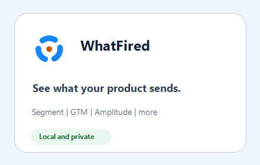

# WhatFired: Open-source analytics event tracker and debugger

<p align="center">
  
</p>

**See what your product sends.**

WhatFired is a Chrome analytics debugger that shows the events a website sends as you click, submit forms and move between pages. It connects each interaction with the event names and properties that appeared after it so you can debug tracking and build funnels without reading raw JSON or digging through the Network tab.

Built for product teams, analytics and engineers working with Segment, GA4, Google Tag Manager, Amplitude, Mixpanel, RudderStack, PostHog and more.

<p align="center">
  
</p>

## Find the event you need in seconds

Use WhatFired when you need to:

- See which analytics events fire after a click, submission or navigation
- Find the exact event name and properties needed for an Amplitude or Mixpanel funnel
- Debug missing, duplicate or unexpected tracking events
- Check Segment, GA4 and Google Tag Manager implementations without opening developer tools
- Identify experiment and A/B test exposure events
- Copy event names and individual property values directly from the popup

There is no recording session to start. Open WhatFired and interact with the page.

## How it works

1. Open WhatFired on the page you want to inspect.
2. Click, submit or navigate normally.
3. Reopen the popup to see the actions, analytics events and properties that followed.

Recent activity remains available as you move between pages. You can filter by analytics provider, search by event or property and open raw JSON only when you need it.

## Why not just use the Network tab?

| Network tab | WhatFired |
| --- | --- |
| Shows every request | Focuses on analytics events |
| Requires reading payloads | Surfaces event names and useful properties |
| Hard to connect requests with actions | Groups events under the interaction they followed |
| Provider-specific formats | Normalizes common analytics providers |
| Manual copying from JSON | Copies individual names and values |

WhatFired does not replace developer tools. It makes the most common analytics QA workflow faster and easier to share across a team.

## Analytics tools supported

- Segment
- Google Analytics 4 and Google Tag Manager
- Amplitude
- Mixpanel
- RudderStack
- PostHog
- Heap
- Snowplow
- Dreamdata
- Attribution
- Compatible first-party and custom analytics endpoints

WhatFired observes common analytics SDK calls, `dataLayer` pushes and analytics requests sent with `fetch`, XHR or `sendBeacon`.

## Install

Until the Chrome Web Store listing is live, install WhatFired locally:

1. Download or clone this repository.
2. Open `chrome://extensions` in Chrome, Brave or another Chromium browser.
3. Enable **Developer mode**.
4. Choose **Load unpacked**.
5. Select the `extension` folder.
6. Pin WhatFired and open it on a normal website.

## Private by design

WhatFired is useful on work products because its architecture is intentionally small and local:

- No account
- No developer-operated server
- No external requests made by the extension
- No captured analytics data sent to the developer
- Temporary access when you open the extension
- Optional website access requested one origin at a time
- Session captures cleared when the browser restarts
- No access to cookies, downloads, browsing history, native applications or the local file system

Read the full [privacy policy](docs/privacy-policy.html) and [security design](extension/SECURITY.md).

## Open source

WhatFired is open source so teams can inspect how it handles website access and captured analytics data. Contributions for additional analytics providers, event formats, accessibility and performance are welcome.

If WhatFired saves you time, star the repository and share it with someone who still debugs analytics events in the Network tab.

## Development

The extension has no build step, package manager or remote dependencies. Edit the files in `extension/` and reload the unpacked extension from `chrome://extensions`.

The included fixture is available at `extension/test/fixture.html`. See the [extension documentation](extension/README.md) for testing instructions, known limitations and implementation details.

## Repository structure

```text
whatfired/
├── assets/       README images
├── docs/         Website and privacy policy
├── extension/    Browser extension source
├── LICENSE
└── README.md
```

## License

WhatFired is available under the [MIT License](LICENSE).

WhatFired is independently developed by Alejandro Carrillo. Product names belong to their respective owners.
